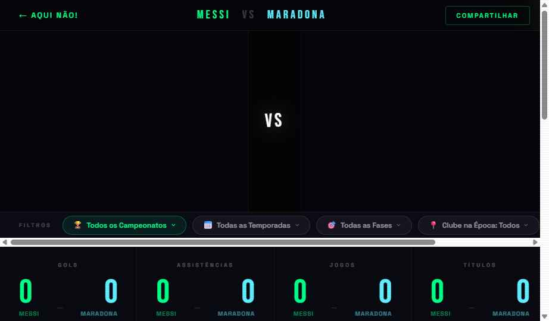

<p align="center">
  
</p>

<h1 align="center">⚽ AQUI NÃO!</h1>

<p align="center">
  <strong>Football player career comparison</strong><br>
  <em>Real data, debate settled.</em>
</p>

<p align="center">
  <a href="#features">Features</a> ·
  <a href="#preview">Preview</a> ·
  <a href="#installation">Installation</a> ·
  <a href="#usage">Usage</a> ·
  <a href="#technologies">Technologies</a>
</p>

---

## Features

- **Real-time search** — type a name and see players with name, nationality and club
- **Full comparison** — goals, assists, appearances, minutes, injuries and titles
- **Interactive charts** — season-by-season evolution, age-based comparison, career projection
- **Epic duels** — Messi vs Maradona, Pelé vs Maradona, CR7 vs Messi in one click
- **Swap players** — change players right on the comparison screen
- **Multi-source data** — FBref, Transfermarkt and Football-Data.org

## Preview

<p align="center">
  
</p>

<p align="center">
  
</p>

## Installation

```bash
# Clone the repository
git clone https://github.com/saironbusatto/Aqui_nao.git
cd Aqui_nao

# Install dependencies
pip install -r requirements.txt
```

## Usage

```bash
# Start the server
cd src
python3 -m flask --app app run

# Open
# http://localhost:5000
```

## Tests

```bash
# Run all tests
python3 -m pytest tests/ -v

# With coverage
python3 -m pytest tests/ --cov=src --cov-report=term-missing
```

## Technologies

| Layer | Technology |
|--------|-----------|
| Backend | Python + Flask |
| Frontend | vanilla HTML/CSS/JS + Chart.js |
| Data | soccerdata (FBref), requests+bs4 (Transfermarkt), football-data.org |
| Tests | pytest + pytest-cov |
| Design | Dark neon theme (Aqui Não! Design System) |

## Structure

```
src/
├── app.py                  # Flask routes + player database
├── collectors/             # External data collectors
├── models/                 # Immutable dataclasses (Player, Comparison)
├── services/               # Business logic (comparison, projection, report)
├── utils/                  # Cache and helpers
├── templates/              # Home + Compare (dark neon theme)
└── static/css/             # Custom styles
```

## License

MIT

---

<p align="center">
  Made with ⚽ by <a href="https://github.com/saironbusatto">saironbusatto</a>
</p>
